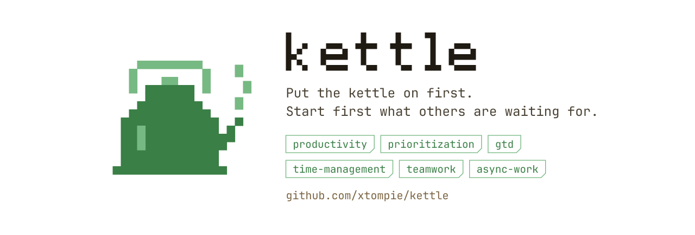

<picture>
  <source media="(prefers-color-scheme: dark)" srcset="assets/banner-dark.svg">
  
</picture>

**Put the kettle on first.** Sort your tasks by how much they depend on other people's time.

## In short

1. **Look at everything.** Once a day, go through all your tasks. For each: what it is, the next step, who it depends on, how hard. Without this, the next steps don't work.
2. **Send what goes to others.** Requests, delegations, questions. No work of your own. Just start their clock.
3. **Prepare what will unblock others.** Your own work that someone needs next: an analysis, a meeting to set up. Do it now, so they get it sooner.
4. **Then do what only needs you.** Clear tasks, nothing from outside. They can wait: their clock depends only on you.

## The kettle

You want tea and a sandwich. You put the kettle on first, then make the sandwich while the water boils. Nobody makes the sandwich first and then stands by the kettle.

Your tasks work the same way. Some of them only finish when someone else does their part. That waiting is the longest part of the task, and it only starts when you hand it over. So hand it over first. Then do your own work while the water boils.

## The steps

### 1. Look at everything (once a day)

Go through every task you have, not only the urgent ones. For each, write a short note:

- what it is about,
- the next concrete step,
- who or what it depends on,
- how hard it is.

This gives you the big picture: what matters, what waits on whom, what is big. Without it you sort blindly, and you grab whatever is on top. Keep the notes short. On most days you only update them.

### 2. Send what goes to others

Anything another person has to do: a question to a colleague, a task for your team, a request to another department, an email that needs an answer. It takes you minutes. Do it at the start of the day, so their part starts now and not this evening.

Example: you need numbers from finance for Thursday. Ask at 9:00, not at 16:00.

### 3. Prepare what will unblock others

Tasks where you need someone later, but first have to do your part: write the brief before the designer can start, prepare the data before the review, set up the meeting before the decision. Do these before your own work, so the other side gets the ball as early as possible.

Example: a decision needs a meeting with three people. Send the invite with the agenda today. Their calendars are the slow part, not your agenda.

### 4. Then do what only needs you

Clear tasks that nobody else touches. They are often the most pleasant ones, and that is the trap. Their clock depends only on you, so they lose nothing by waiting until after steps 2 and 3.

## Common mistakes

- **Starting with your own work.** It feels productive. Meanwhile three people wait for a message that takes two minutes.
- **Holding a request until it is perfect.** Send the question now. Refine it later if needed.
- **Sorting only by urgency.** Urgent and blocking others are not the same. A non-urgent task that someone waits on goes first.
- **Skipping the review.** Without it you don't know what blocks whom. The order then depends on what you happen to remember.

## Use it with an LLM

Paste your task list after this prompt:

```text
Sort my tasks with the Kettle method (https://github.com/xtompie/kettle).

1. Look at everything: for each task write one short line: what it is,
   the next step, who or what it depends on, how hard it is.
   If something is unclear, say so instead of guessing.
2. Send what goes to others: requests, delegations, questions.
   Only the sending, no work of my own.
3. Prepare what will unblock others: my own work that someone
   needs next.
4. Then what only needs me.

In steps 2 to 4, start with what the other side needs soonest.
For step 2, draft the messages I should send.

My tasks:
```

## Where it comes from

- **Getting Things Done**, David Allen: get every task out of your head and give each a next action. That is step 1. https://gettingthingsdone.com/what-is-gtd/
- **Do, Delegate, Defer, Delete** (the Eisenhower matrix): the same decisions, here sorted by how long others wait. https://www.eisenhower.me/eisenhower-matrix/
- **Theory of Constraints and the critical path**, Eliyahu Goldratt: the task with the longest wait sets the finish date, so it has to start first. https://en.wikipedia.org/wiki/Theory_of_constraints, https://en.wikipedia.org/wiki/Critical_path_method

## License

MIT
